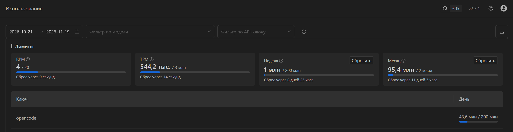

# Quotas

The **Limits** tab on the Usage page shows the quotas the gateway enforces
against your traffic right now: how much of each allowance is spent, when
every window resets and — for the weekly and monthly budgets — a reset
button. The section is always self-scoped: you see your own limits, and an
administrator can also pin any user from the picker above the card.

## The Limit Cards

Each card carries a spent / limit readout, a progress bar and a reset countdown.
The `?` icon on a card explains its window.

| Card      | Window                                                                                  | Reset                                            |
| --------- | --------------------------------------------------------------------------------------- | ------------------------------------------------ |
| **RPM**   | Requests per minute — a sliding 60-second window.                                       | Continuously, as the oldest requests age out.    |
| **TPM**   | Tokens per minute — the same sliding window, counted in tokens.                         | Continuously.                                    |
| **Week**  | Tokens over a rolling 7-day window, shared across all of your API keys and UI sessions. | Continuously, as week-old usage ages out.        |
| **Month** | Tokens in the calendar month.                                                           | At the month boundary, in the deployment timezone. |

When a limit is hit, further requests are rejected at the gateway with
`429 Too Many Requests` — before any model instance is contacted — until the
window frees up again. The rejection body names the limit that tripped (for
example `Too many requests per minute`, `Monthly token quota limit reached,
reset in usage overview` or `Too many concurrent requests for this model`), and
rolling and calendar windows carry a `Retry-After` header with the seconds
until the window frees up. RPM and TPM guard against short bursts; the weekly
and monthly budgets cap sustained consumption. A request counts against every
window it can touch: your API-key traffic and your UI sessions draw on the same
user-level allowance.

## Concurrency by Model

The table under the cards lists the ready models you can reach, busiest first:
how many of your own requests to each model are running right now, and the
effective limit for that model — the administrator's per-model override if one
is set, the deployment default otherwise. A model whose running count sits at
its limit is the source of the `429 Too Many Concurrent Requests` rejections.

## Model Concurrency

Beyond the rate and budget windows, the gateway caps how many of your requests
— across all of your API keys and sessions — may run against a single model at
the same time. The deployment default is **2**: while two requests to a model
are still running, a third parallel request to the same model is rejected with
`429 Too Many Requests` until one of them finishes. The slot frees up the
moment a request completes — there is no window to wait out, so the rejection
carries no `Retry-After` header.

Each model is counted separately: a running request against one model does not
block requests against other models. Administrators are not subject to this
limit.

The default and the per-model overrides are set by the administrator on your
account. A model without an explicit override follows the deployment default,
and an override of `0` lifts the cap for that model entirely.

## Where the Numbers Come From

- **Deployment defaults** — set by the administrator for everyone: RPM, TPM,
  monthly tokens and the per-model concurrency cap. An unset default means that
  window is not limited.
- **Per-user budgets** — weekly and monthly token budgets an administrator sets
  on your account, shared across all of your keys and sessions. RPM and TPM
  limits set on your account are user-level the same way.

This deployment ships the following defaults (administrators edit them on the
Usage → Limits tab, see [Editing the Deployment Defaults](#editing-the-deployment-defaults)):

| Window      | Default                                 |
| ----------- | --------------------------------------- |
| RPM         | 10 requests / minute                    |
| TPM         | 768,000 tokens / minute                 |
| Month       | 100,000,000 tokens per user             |
| Week        | no default — only accounts with an explicit weekly budget are capped |
| Concurrency | 2 requests per model                    |

The internals — gateway configuration, defaults, failure behaviour and metrics
— are described in [Rate Limiting](rate-limiting.md).

## Editing the Deployment Defaults

Administrators edit the deployment defaults — RPM, TPM, the monthly token
budget and the per-model concurrency cap — on the Usage → Limits tab
(**Deployment defaults**). An empty field inherits the value from the server's
configuration file; a concurrency of `0` turns the cap off. A save lands on
the gateway at the next reconcile pass (within a minute), without a restart.

## Free Windows

The same form publishes the deployment's **free window**: a daily time span
(which may span midnight) plus whole free days, stored in UTC. While the
schedule is active the gateway suspends rate limiting entirely — every request
is admitted, no concurrency slots are taken, and the limit counters freeze.

A request that **starts** inside the window runs free for its whole duration,
even if it streams past the window's end; one that started outside stays fully
limited. Usage statistics and reports keep being collected as usual — only the
limit accounting stops.

While the window is active, the Limits card shows a **Free hours** badge, so a
frozen counter is not mistaken for a broken read. The form shows the times in
your browser's local timezone and converts them to UTC on save; the days
follow UTC.

## Resetting a Budget

The **Week** and **Month** cards carry a **Reset** button. Pressing it drops the
window's counter to zero immediately: the budget restarts without waiting for
the natural boundary. Usage already recorded stays in the usage reports — only
the quota counter is affected.

A press requires a reason. The note is stored together with the press — who,
when and why — so the audit trail shows how each budget came to restart.

!!! note

    Resets apply to the weekly and monthly budgets only. RPM, TPM and the
    model concurrency cap are short-lived: the counters free up on their own
    as requests age out or complete.

### Reset Quota

Two resets per window are free. The quota floats with the presses themselves:
two resets inside one week make the next one available a week after the first
press, not on the next calendar boundary. When both are spent, the button
disables until the oldest press ages out of the window — hovering the disabled
button shows the date the next reset becomes available.

Administrators are not quota-limited: an administrator can reset a budget at
any time — their own or another user's — and an administrator's presses never
consume the user's own two free resets.
